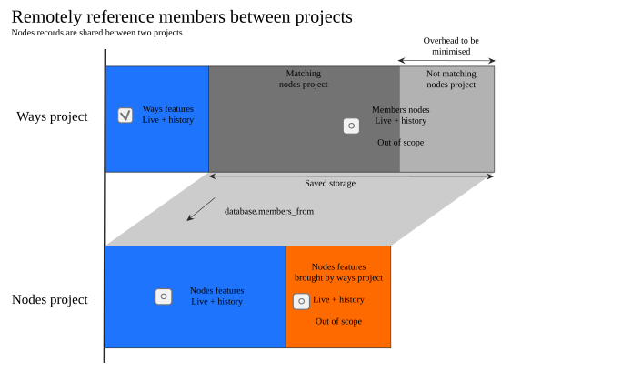

# Configuring projects

Each project is defined via a subdirectory of `projects'. Each subdirectory must contain the following files :

- `info.json` : project metadata
- `howto.md`: description of tasks to be performed in Markdown format (use title levels >= 3)
- `contribs.sql` : SQL script containing UPDATE request on `pdm_features` table, to set contribution classes to certain type of OSM changes and associate points
- `extract.sh` : Optional script that produces a csv export to be available for download on the web interface.

The properties in `info.json` are as follows:

- `id`: Unique integer identifier
- `name`: mission identifier (authorized characters: A-Z, 0-9, \_ and -)
- `title`: name of the mission (short enough)
- `init_slot`: Initialisation rank, starting at 1
- `start_date`: start date of the mission (format YYYY-MM-DD)
- `soft_start_date`: start date of the _strong_ community animation period (format YYYY-MM-DD). Ignored unless `use_soft_dates` is enabled. Data collection still starts at `start_date` either way.
- `soft_end_date`: end date of the _strong_ community animation period (format YYYY-MM-DD). Ignored unless `use_soft_dates` is enabled. Data collection still runs until `end_date` either way.
- `use_soft_dates`: whether to use `soft_start_date` and `soft_end_date` (instead of `start_date` and `end_date`) to decide whether this project is past, current or next, and to bound the period over which points, leaderboard and badges are computed. Changing it is only taken into account by the next `update_changes` run and applies to contributor counts only in dates processed after the change.
- `end_date`: end date of the mission (format YYYY-MM-DD)
- `summary`: summary of the mission
- `links`: object with one or more URLs to third party pages
  - `osmwiki`: OSM wiki
  - `osmforum`: OSM forum
  - `osmblog`: OSM blog page
  - `external_statistics`: External page for statistics, if specified it will be used INSTEAD of the built-in statistics
- `database.osmium_tag_filter` : Osmium filter on the tags to be applied to keep only the relevant OSM objects (for example `nwr/*:covid19`, [syntax described here](https://osmcode.org/osmium-tool/manual.html#filtering-by-tags)). It is possible to list many filters using `&` character and same syntax.
- `database.imposm`: configuration for importing updated OSM data (`types` for geometry types to be taken into account, `mapping` for attributes, see [the Imposm documentation](https://imposm.org/docs/imposm3/latest/mapping.html#tags) for the format of these fields)
- `database.compare`: configuration for the search of OpenStreetMap objects to compare, follows the format of `database.imposm` with an additional property `radius` (reconciliation radius in meters)
- `database.labels`: Labels definitions that are assigned to each feature version depending on their tags. Each label is associated to a JSON path used by [jsonb_path_exists](https://www.postgresql.org/docs/current/functions-json.html#FUNCTIONS-JSON-PROCESSING-TABLE) over each feature tags. Example `"labels":{"label1":"$ ? (@.substation==\"transmission\")"}` to assign `label1` to any object that holds `substation=transmission`. See below about filtering.
- `database.live`: Enable computations that involve live table, populated by imposm or any other process (see replacing imposm below).
- `database.members_from`: A remote project's name from which members of features are fetched. It optimise the database's size in case of nested ways/nodes analysis. 
- `datasources`: list of data sources that appear on the page (see below)
- `teams` : list of teams used to build statistics and defined with their name corresponding to a OSM usernames table.
- `statistics`: configuration of statistics display on the project page
- `statistics.count`: enable projects features counting
- `statistics.length` : enable length and surface measurement on projects features. Don't forget to reinit project to enforce any change.
- `statistics.labels` : enable contribution classification in labels tables. As a consequence, it produces users contribution on labels too.
- `statistics.feature_name`: name to display to the user for these objects
- `statistics.osmose_tasks`: name of the tasks performed via Osmose
- `statistics.points`: configuration of the points obtained when contributing to the project (in relation with `contribs.sql`). `{"add":1, "edit":2}`
- `statistics.points_labels`: configuration of the points obtained when contributing to a given label (in relation with `contribs.sql`). `{"label1": {"add":1, "edit":2}}`
- `editors`: specific configuration to each OSM editor. Podoma is described below, for iD, it is possible to use [the parameters listed here](https://github.com/openstreetmap/iD/blob/develop/API.md).

## Projects timeline

Each project comes with its own timeline definition. It will influence several processings to keep change log up to date along time.  
Script `project:update` will automatically chose the most appropriate data source to feed the necessary update for each project:
- OSH files which provide all features with they history, over a given geographical area. They are released each month.
- Daily diffs which expose changes that occured during a given day worldwide.

Podoma allows whether daily update and complete rebuild of a terminated project history over the whole time period. This second option is particularly useful in case of significant change in the software or in the project extent.
A project can be configured without end date, with `end_date: null`, to enable endless updates.


- 1st case: An old project with an end date which completely fits in the OSH file availability. It doesn't need updates but can be reinit on demand.
- 2nd case: An old project without end date, too old to be updated with diffs files and requires to be reinited to reach current date.
- 3rd case: An old project without end date, recently updated and for which daily diffs update are applicable until current date.
- 4th case: An old project with an end date in the future, on which daily diffs updates are applicable until current date.
- 5th case: A recently began project with an end date in the future, on which daily diffs updates are applicable until current date.
- 6th case: A project to began in the future, which doesn't require any processing currently.

## Filtering features


A project may be summarized as upside: Perimeter filter accumulates features which comply and then labels can be assigned to qualify with more details.

### Perimeter

Podoma makes use of Osmium and Imposm to filter necessary features according to each project's configuration, with the help of `database.osmium_tag_filter` and `database.imposm` keys.

Perimeter filter must be selective enough to deal with reasonable amount of features. It must be wide enough to take care of several tagging practices in OSM community for the topic that matters. It is then recommended to focus on main tags here and use labels to get in details about classification, see below.

Documented syntax of filters is available in [Osmium documentation online](https://docs.osmcode.org/osmium/latest/osmium-tags-filter.html). However, due to the need to apply those filters at several steps of the processing, including outside of Osmium logic, filters that would use `!=` operator aren't currently supported.

### Labelling
As to complete filtering functionality, Podoma supports the assignment of labels to each version of features depending on their tags.  
Each version can be assigned with 0, 1 or more labels. Then each label can cover part or the whole project.

Labels are then used in counts and KPI to distinguish several population fo features inside the same project. It it then recommended to consider a wide project filter to include even imperfect features and not only the perfect ones and then separate them with labels. Consumers will then not only spot the population covered by the project but the ones that should be completed to be included in it as well. 

The syntax that is used to define labels conforms to [Postgresql's SQL/JSON](https://www.postgresql.org/docs/current/functions-json.html#FUNCTIONS-SQLJSON-PATH) which supports types. You can use the following example to define your own labels:

```json
"labels":{
  "label1":"$.char_key",
  "label2":"$ ? (@.\"char:key\" == \"value\")",
  "label3":"$ ? (@.numeric_key < 20000)",
  "label4":"$.numeric_array_key ? (@ < 20000)",
  "label5":"$ ? (@.numeric_array_key[*] > 10000 && @.char_key != \"value\")",
  "label6":"$ ? (@.numeric_array_key[*] > 10000 && !exists(@.char_key_unknown))"
}
```

Labels assignement is done during the `update_changes` phase. They could only be reseted by initialization to propagate a change on labels definition for instance. There is no particular logic to edit assigned labels.  
Contribution classification is only done if `statistics.labels` is `true` for a given project.

However, it is possible to manually delete and do the assignment of a particular label `label1` with the following commands:

```bash
psql -d postgresql://... -c "DELETE FROM pdm_features_project_labels WHERE label='label1'"
psql -d postgresql://... -v features_table="pdm_features_project" -v labels_table="pdm_features_project_labels" -v label="'label1'" -v labelfilter="'... new label filer ...'" -f "db/27_changes_labels.sql"
psql -d postgresql://... -v features_table="pdm_features_project" -v labels_table="pdm_features_project_labels" -f "db/27_changes_labels_contrib.sql"
```

Then, the `update_projects` should be inited again to propagate the new labels into counts and KPI.

### Remote members
Projects involving ways and relations will also store referenced members, mostly for sake of geometry rebuild. Nodes are indeed necessary to know a way's length or a polygon's surface.

Depending on the field you are interested in, it's not unusual to observe contribution on ways and their member nodes as well.  
So, storing members twice wouldn't be efficient.



Podoma allows to get members from a different project as to avoid duplication of storage. It will automatically deduplicate members before storing them in the remote table, outside of the remote project's scope. It won't disrupt statistics and exports of selected features.  
Use `database.members_from` to set the remote project name from where the members can be retrevied.

To take advantage of this feature, don't forget to plan project's initialisation accordingly, by setting `init_slot` property. Remote projects that hold members must be inited before anything else, with a lower slot than other projects.

### Missing OpenStreetMap features
As explained upside, Podoma uses the daily diffs to keep projects updated.  
Those diffs files only contain modified features and even if a way or a relation may be included in it, none of their members will be mentioned is they hadn't been edited themselves. Moreover, those diffs can only be filtered when nodes are located inside the desired geographic area.  
It can finally causes issues when some unknown features in the database are referenced by ways or relations or that only ways or relations were edited without touching nodes.

Podoma only keeps track of useful features for projects, it needs to check after each update if unknown features should be retrieved.  
Overpass API is used by projects which require to get such missing members. A single query is sent to retrieve all nodes, ways, relations and their descendents to take care of recursivity. Thus a query covering 10 missing features can lead to a greater amount of results.

Those features are then processed the same way than the ones we got from daily diffs files. This process complete the temporary files without any particularism.

To disable this retrieval, just set a `null` in `OVERPASS_URL` in your Podoma configuration file.
* No additional configuration is necessary to seek for missing ways or relation members
* Put `database.live` to true in your project configuration to seek for missing features from live updated table.

Those two modes are combined. All features are retreived through a single Overpass query at each attempt.

### Contributions taggings
Podoma operates a more detailed tagging of contributions out of 3 [OsmChange](https://wiki.openstreetmap.org/wiki/OsmChange) categories (add, modifiy, delete).  
Furthermore, it distinguishes project level and label levels. Features can be independently added and removed from labels and kept in project along their lifecycle.

Similarly to labels, contribution taggings are useful for KPI computing as a global framework to group very diverse contributions under the same term.

Contributions tagging are established in `pdm_features_...` tables for project level and labels tables for label level. Podoma now considers following global values:

* Project level:
  - `add`: The feature is created in OpenStreetMap and appears in the project
  - `edit-in`: The feature was edited and appears in the project starting a version > 1. It means the mapper hasn't created the feature but made a crucial edit that pushed new features in the project (or restored them)
  - `edit`: The feature was edited and was already included in the project
  - `edit-out`: The feature was edited and aren't part of the project anymore.
  - `delete`: The feature was deleted and was part of the project
* Label level:
  - `edit-in`: The feature was edited and got the mentioned label for the first time or was restored into it.
  - `edit`: The feature was edited and already got the mentionned label on a past version.

Global contribution tagging can be extended for each project by creating a `contribs.sql` file next to `info.json`.
This script contains UPDATE SQL requests to add entries in `pdm_features_...` table. Each OSM change can only have a single type and have a single amount of points associated.

## Counting

Features and contributors counts are done over change log fed by update and filtered by each project's own configuration. Counting features is enabled with the help of `statistics.count` flag.  
Computing suh statistics not only requires existence dates of each version but their validity regarding the project's filter as well.

Each possible configuration can be summarised in this chart: 

Some features may have a complex timeline, gaining and losing tags and validity regarding a given project several times.

Dates on which features are counted are selected by the processing script following a precise logic. The span on which the script is used impacts the way those dates are selected. Starting from the current date, we keep the following:
- Each day at midnight until last count update or 1st day of the current month
- First day of each month until the last count update or beginning of the project

Running the count script each day will lead to 364 values at the end of a complete year.

Project statistics are made by `./db/31_projects_update_tmp.sh` script. This script fills `pdm_feature_counts` SQL table with missing daily data according to last OSH file timestamp and current day.

It is possible to force full recount for a project by deleting OSH timestamp file, retrieve again PBF/PBH files and launch again the script:

```bash
rm ${WORK_DIR}/osh_timestamp
./db/11_pbf_update_tmp.sh
./db/31_projects_update_tmp.sh
```

### Features counting

The following counts are currently supported:
- Total amount of features that valides the project's filter on a given date.
- Ways length when some get selected by each project's filter
- Area surface when some get selected by each project's filter

### Teams contribution


Teams contribution is for now evaluated at project level only, with or without labels.  
Following counts are done over a time frame between two dates of the timeline upside:
- The actual length contributed by the team, as the sum of lengths delta of each version linked to each team member
- The actual surface contributed by the team, as the sum of surface delta of each version linked to each team member

Figure upside tries to explain how two teams contributions are counted over a way edited 5 times by 3 différent mappers.  
Currently, contributions that removes feature out of a label can't be counted. As a result for each label, only positive contributions are part of the total.

### Contributors counting

The following counts are currently supported:
- Total amount of contributors involved by features version in project's change log
- Amount of contributors involved on features versions on a 24 hours time window
- Amount of contributors involved on features versions on a 30 days time window

The total amount of contributors should not be understood as the total amount of contributors involved since OSM beginning on project's perimeter.  
Actually, we only select existing versions at the beginning of the project. It avoid contributors involved on completely deleted objects and previous versions.

### Points and gamification

Certain OSM contributions can give points to users.
Each project configuration set how many points are given according to contribution tagging, in `info.json`:

```json
{
  "statistics": {
    "points": { 
      "add": 3,
      "project1": 1
    },
    "points_label": { 
      "label1": {
        "edit-in": 3,
        "edit": 1
      }, 
      "label2": {
        "edit-in": 3,
        "edit": 1 
      }
    }
  }
}
```

Points are distinguishsed between project and label contributions.

Points are only counted over the project period, which drives the leaderboard and the badges given to each contributor. That period runs from `start_date` to `end_date`, or from `soft_start_date` to `soft_end_date` when `use_soft_dates` is enabled for the project. Contributions made outside of it are still collected and displayed in the statistics, but don't give any point.

## Data sources

Several data sources can be used, and are to be displayed in the `datasources` field of the `info.json` file.

### Osmose

[Osmose](https://wiki.openstreetmap.org/wiki/Osmose) is a tool for quality analysis and open data integration. The properties to be filled in are the following:

- `source` (mandatory `osmose`): source type
- `item`: item number (four-digit code)
- `class` (optional): class number (multi-digit code)
- `country` (optional): Osmose country name pattern (example `france*`)
- `name`: name to be displayed to the user
- `subtitles` (optional): key object > value to replace the subtitles of Osmose reports (search by pattern)
- `buttons`: label to be displayed on the edit buttons (example `{ "done": "It's done", "false": "Nothing here" }`)
- `minzoom` (default 7): minimum zoom level for making this layer visible
- `maxzoom` (default 18): maximum zoom level for making this layer visible
- `tiles` (default): TMS URL list

### OSM Notes

The [OpenStreetMap notes](https://wiki.openstreetmap.org/wiki/Notes) are a simple method for sending text comments on the map, and facilitate contribution by novice audiences. The properties to be filled in are the following:

- `source` (mandatory `notes`): source type
- `name`: name to be displayed to the user
- `description`: descriptive text explaining the resolution method for a note
- `terms`: list of terms to search for in the notes (singular)
- `buttons`: label to display on the edit buttons (example `{ "close": "It's done" }`)
- `data` (default): data in Geojson format

### OpenStreetMap objects

Objects currently present in OpenStreetMap can be displayed to avoid duplicates and allow editing. The properties to be filled in are the following:

- `source` (mandatory `osm`): source type
- `name`: name to be displayed to the user
- `description`: descriptive text of the displayed object
- `minzoom` (default 7): minimum zoom level for making this layer visible
- `maxzoom` (default 14): maximum zoom level for making this layer visible
- `tiles` (default): TMS URL list
- `layers` (default): Layer names list to use and corresponding to `tiles` indices

This source can appear only once, and corresponds to the objects searched for in the `database` options of `info.json`.

### OpenStreetMap objects for comparison

Objects indirectly related to the project but relevant to the contribution may also appear. The properties to be filled in are the following:

- `source` (mandatory `osm-compare`): type of source
- `name`: name to be displayed to the user
- `description`: descriptive text of the displayed object
- `minzoom` (default 9): minimum zoom level for making this layer visible
- `maxzoom` (default 14): maximum zoom level for making this layer visible
- `tiles` (default): TMS URL list
- `layers` (default): Layer names list to use and corresponding to `tiles` indices

This source can only appear once, and corresponds to the objects searched for in the `database.compare` options of `info.json`.

### OpenStreetMap extra objects

Objects outside the project's scope, displayed as to inform contributors that something different already exists in place. The properties to be filled in are the following:

- `source` (mandatory `osm-extra`): type of source
- `name`: name to be displayed to the user
- `description`: descriptive text of the displayed object
- `minzoom` (default 9): minimum zoom level for making this layer visible
- `maxzoom` (default 14): maximum zoom level for making this layer visible
- `tiles` (default): TMS URL list
- `layers` (default): Layer names list to use and corresponding to `tiles` indices

This source can appear as many time as required

### Background imagery

Raster tile imagery can be added in background to make contribution easier or give context. You have to define following properties:

- `source` (mandatory `background`): type of source
- `icon` (default `other`): symbol to display in legend (between `aerial`, `thematic`, `picture`, `other`)
- `name`: name shown to users
- `tiles` (default): list of TMS URL
- `attribution`: attribution to display on map
- `minzoom` (default 2): minimum zoom level for making this layer visible
- `maxzoom` (default 19): maximum zoom level for making this layer visible
- `tileSize` (default 256): width and length of a tile in pixels

These sources should be declared in reverse order of display. The lower layer should be declared first.
The urls of raster tiles are available in this repository https://github.com/osmlab/editor-layer-index

### Sources stats

Another kind of datasource can be added and refers to geographical statistics, over administrative boundaries for instance

- `source` (mandatory `stats`): statistics source type
- `minzoom` (default 2): minimum zoom level for making this layer visible
- `maxzoom` (default 14): maximum zoom level for making this layer visible
- `tiles` (default): list of TMS URL
- `layers` (default): Layer names list to use and corresponding to `tiles` indices

## Integrated editor

Project configuration allows to customize embedded editor with appropriate fields. Let's consider following json to be set in the `editors` list:

```json
"pdm": {
  "fields": [
    ... fields list...
  ],
  "title": {
    "add": "Add action label",
    "edit": "Edit action label"
  }
}
```

Fields are defined with standard JSON objects added to the `fields` array in the uspide json.
Every type except `hidden` supports those common attributes:

- `name`: Field name to be displayed to the user
- `help`: HREF link to a relevant help page regarding this particular field
- `description`: An extensive text displayed to the user providing details about the field
- `optional`: A boolean false/true field making the field respectively mandatory or not

### Static or external attributes

Define static tags to be added to every created object by the editor, or retrieve existing values from external sources (like identifiers from Osmose such as `ref:FR:SIRET` tag, use in that case `*` value).

```json
{ "type": "hidden", "tags": { "tag_1": "value_1", "tag_2": "value_2", "external_tag_3": "*" } }
```

### Scalar field

Text fields comes with 3 different types: text, number or email.
They're all producing a standard text field, leading to a given OSM key with appropriate validation features.

```json
  { "type": "text", "name": "Field label", "tag": "tag_key", "optional": false },
  { "type": "number", "name": "Field label", "tag": "tag_key", "optional": false },
  { "type": "email", "name": "Field label", "tag": "tag_key", "optional": false }
```

### Textarea field

A wider textarea field similar to text one.

```json
{ "type": "textarea", "name": "Field label", "tag": "tag_key", "optional": false }
```

### Drop down list

A drop down list with custom entries leading to a given OSM tag

```json
{
  "type": "select",
  "name": "Field label",
  "tag": "tag_key",
  "optional": false,
  "values": [
    { "v": "value_1", "l": "Value 1 label" },
    { "v": "value_2", "l": "Value 2 label" }
  ]
}
```

You can also set multiple tags using a single value in the list, for example:

```json
{
  "type": "select",
  "name": "Type",
  "tag": "_select1",
  "values": [
    {
      "l": "National police",
      "tags": { "name": "National police", "operator": "National police", "police:FR": "police" }
    },
    { "l": "City police", "tags": { "name": "City police", "police:FR": "police_municipale" } }
  ]
}
```

In case of multiple tags for a single value, you can force removal of certain tags with empty strings, for example to cover objects that belongs to different categories:

```json
{
  "type": "select",
  "name": "Type de commerce",
  "tag": "_select1",
  "values": [
    { "l": "Agence d'assurance", "tags": { "shop": "", "office": "insurance" } },
    { "l": "Agence de voyages", "tags": { "shop": "travel_agency", "office": "" } }
  ]
}
```

### 2 or 3 states

States input are using radio buttons to provide 2 or 3 options to the user. It leads to a given OSM key.
`2states` is yes/unknown and `3states` is yes/no/unknown.

```json
  { "type": "2states", "name": "Field label", "tag": "tag_key"},
  { "type": "3states", "name": "Field label", "tag": "tag_key"}
```

### Brands and operators

To make brand or operators input easier, you can use the `nsi` field (related to [Name Suggestion Index](https://nsi.guide/), a collaborative listing of all brands and operators worldwide). It has specific options:

- `path` : path to brand listing to use (this appears in website title, for example `brands/shop/coffee`)
- `locationSet` : a two-letter, lowercase country code to only list brands from this specific country (optional)

For example:

```json
{ "type": "nsi", "name": "Brand", "path": "brands/shop/bakery", "locationSet": "fr" }
```

### Icons group

Icon select fields allow simple selecting of several similar attributes, for example available sockets at a charging station or kind of waste accepted in a recycling container. Icons must be available in the `/website/images/form` folder, as PNG image. Tags associated to an icon are applied on feature if icon is selected.

```json
{
  "type": "icons",
  "name": "Available sockets",
  "tag": "_socket",
  "values": [
    { "icon": "socket_typee", "label": "TE", "tags": { "socket:typee": "yes" } },
    { "icon": "socket_type2", "label": "T2", "tags": { "socket:type2": "yes" } },
    { "icon": "socket_type2_combo", "label": "T2 Combo", "tags": { "socket:type2_combo": "yes" } },
    { "icon": "socket_chademo", "label": "Chademo", "tags": { "socket:chademo": "yes" } }
  ]
}
```